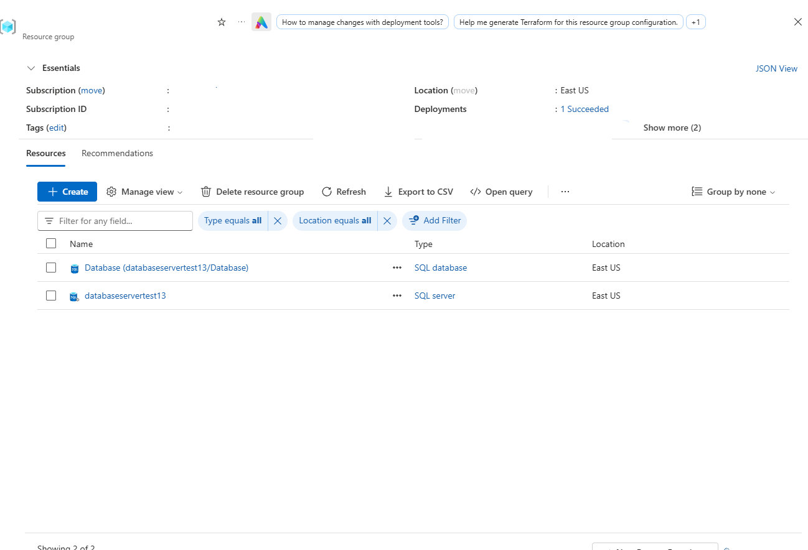
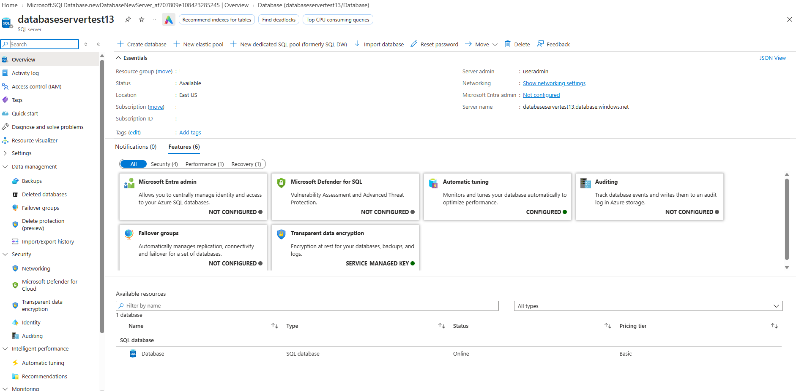
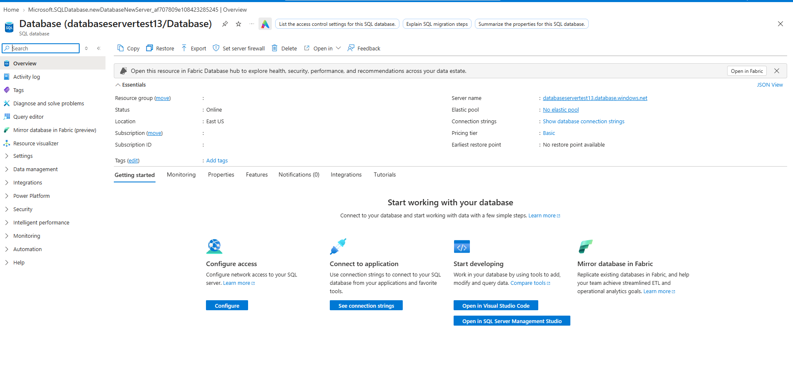
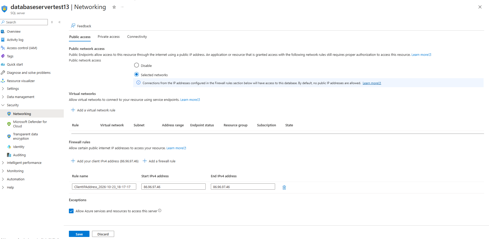
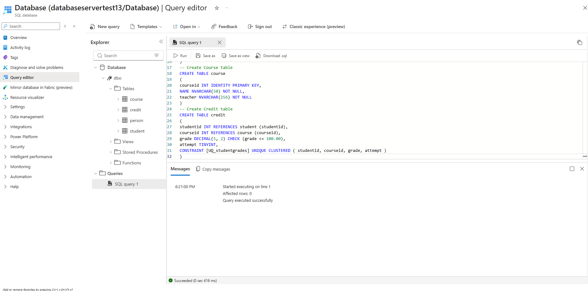

# Provisioning and Managing Azure SQL Database

Comprehensive laboratory infrastructure deployment detailing the creation of a single Azure SQL Database, configuring logical server firewall access rules, and executing T-SQL DDL statements using Azure Portal Query Editor.

---

## 1. Architecture & Provisioned Resources

### Core Infrastructure Topology

| Resource Type | Resource Name | Specification / Tier | Region / Location |
| :--- | :--- | :--- | :--- |
| **Logical SQL Server** | `databaseservertest13` | Azure SQL Logical Server (v12.0) | East US |
| **SQL Database** | `Database` | Basic Tier (5 DTUs, 2 GB Max Size) | East US |
| **Firewall Rule** | `ClientIPAddress_2026-10-23_...` | Inbound IPv4 Rule (`86.96.97.46`) | East US |
| **Firewall Exception** | `AllowAllWindowsAzureIps` | Allow Azure services and resources | East US |

---

### Provisioned Environment Validation

*Resource group overview confirming successful deployment of the logical SQL server databaseservertest13 and SQL database.*[cite: 60]

---

*Logical SQL server overview pane displaying server admin credentials, fully qualified domain name, and associated online database.*[cite: 62]

---

*SQL database overview pane showing Basic pricing tier status and configuration entry points.*[cite: 63]

---

## 2. Step-by-Step Implementation

### Step 1: Configure Logical SQL Server Network Firewall

Navigated to the networking settings of `databaseservertest13`, added a client IPv4 firewall rule for `86.96.97.46`, and enabled the exception for Azure services and resources.

*Networking panel displaying selected networks public access, added client IPv4 firewall rule, and enabled Azure services exception.*[cite: 59]

---

### Step 2: Execute T-SQL Schema DDL Queries in Query Editor

Authenticated to the database via Azure Portal Query Editor using server admin credentials and executed T-SQL DDL scripts to create relational database tables.

*Query Editor interface displaying successful creation of course and credit database tables with relational constraints.*[cite: 61]
